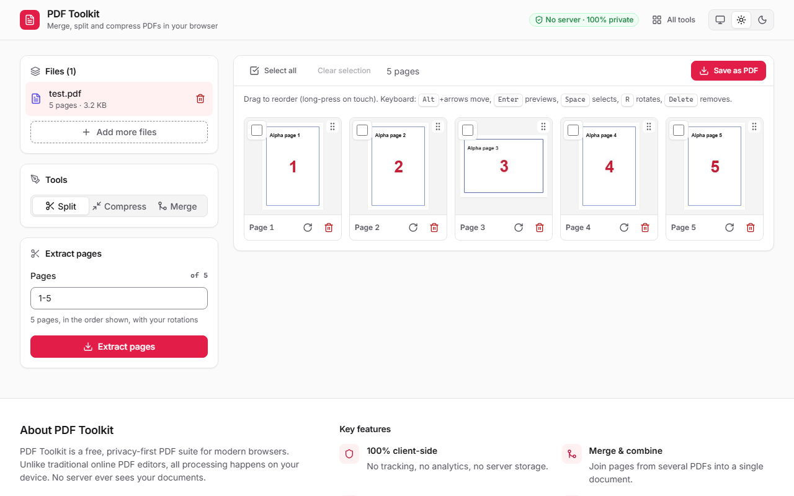
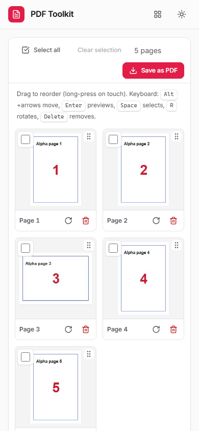
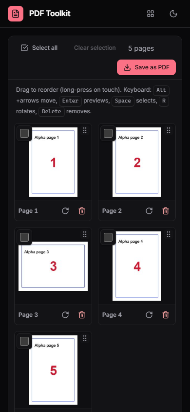

# PDF Toolkit 📄🔨

A powerful, browser-based PDF manipulation toolkit that puts privacy first. All processing happens locally in your browser—your files never leave your computer. Optimized for speed and security.

**Live Demo**: [https://chrisjdj.github.io/PDF-Toolkit/](https://chrisjdj.github.io/PDF-Toolkit/)

<picture>
  <source media="(prefers-color-scheme: dark)" srcset="docs/screenshots/dark-desktop.png" />
  
</picture>

| Light | Dark |
|---|---|
|  |  |

## 🚀 Features

- **Split PDF**: Extract pages with ranges like `1-3, 7, 10-`.
- **Merge PDF**: Combine pages from multiple PDF files, reorder them, and rotate as needed.
- **Compress PDF**: Lossless (qpdf, WebAssembly) or Strong, which also downsizes large photos and scans.
- **Page Management**: rotate, reorder (drag, long-press on touch, or Alt+arrow keys) and remove pages. Edits are kept per file.
- **Performance**:
  - Initial load is ~86 KB gzipped. pdf.js, pdf-lib and qpdf load on demand.
  - Thumbnails render lazily (`IntersectionObserver`), sharp on high-DPI screens.
- **Preview**: full-page zoom view with keyboard navigation.
- **Accessible**: WCAG 2.2 AA contrast in both themes, keyboard operable, skip link, native dialogs, screen-reader labels, reduced-motion support.
- **System / Light / Dark Theme**: follows your OS setting by default (and updates live when it changes); pick Light or Dark in the header. The choice is shared with the other tools in the suite.
- **Responsive**: mobile-first layout from 320px phones to wide desktops, with 44px touch targets.
- **Privacy First**: 100% client-side processing. No server, no uploads, 100% private.

## 🔍 SEO & Accessibility

- **Optimized for Search**: Includes `robots.txt`, `sitemap.xml`, and comprehensive meta tags for better visibility.
- **Structured Data**: JSON-LD schema markup for enhanced search engine results.
- **Accessible Design**: Semantic HTML and improved ARIA labels for screen reader compatibility.

## 🛠️ Technology Stack

- **Framework**: [React 19](https://react.dev/)
- **Build Tool**: [Vite](https://vitejs.dev/)
- **Language**: [TypeScript](https://www.typescriptlang.org/)
- **PDF Manipulation**: [@cantoo/pdf-lib](https://github.com/cantoo-scribe/pdf-lib) (pdf-lib fork with decryption support)
- **Compression**: [qpdf](https://qpdf.sourceforge.io/) compiled to WebAssembly
- **PDF Rendering**: [pdf.js](https://mozilla.github.io/pdf.js/)
- **Icons**: [Lucide React](https://lucide.dev/)
- **Styling**: Sass (SCSS) with the shared token-based design system (see [DESIGN.md](./DESIGN.md))
- **Font**: Inter Variable (self-hosted via Fontsource)

## 🏗️ Getting Started

### Prerequisites

- Node.js (Latest LTS recommended)
- npm or yarn

### Installation

1. Install dependencies:
   ```bash
   npm install
   ```

2. Start the development server:
   ```bash
   npm run dev
   ```

3. Build for production:
   ```bash
   npm run build
   ```

4. Lint:
   ```bash
   npm run lint
   ```

### Project structure

```
src/
  App.tsx            app shell: file loading, exports, preview wiring
  components/        AppHeader, ThemeSwitch, Sidebar, PageGrid, MergeTool, PopupPage, PageCanvas, Thumbnail, ...
  hooks/             useReorder (mouse/touch/keyboard), useThumbnail, useFileDrop, useAlert, useTheme
  styles/            design system (tokens, theme, base, components, shell; shared) + _accent and _app (PDF only)
  state/             editor (per-file page edits) and merge-queue reducers
  lib/               pdfOps (build/compress), pdfjs (lazy loader), thumbnails (cache/queue), utils
```

## 🎨 Design & Theming

The UI uses the design system shared by all the tools in the suite. Read [DESIGN.md](./DESIGN.md) before changing styles: use semantic tokens (no hard-coded colours), reuse the shared components, and check new UI at 320px, 768px and 1280px in both themes. The theme choice is stored in `localStorage['theme-preference']` and applied before first paint.

## 🔒 Privacy & Security

This application is designed to be completely private. It uses `pdf-lib` and `pdfjs-dist` to process PDF files directly in your browser's memory. No data is sent to any external server. 

---

*Built with ❤️ for productivity and privacy.*
